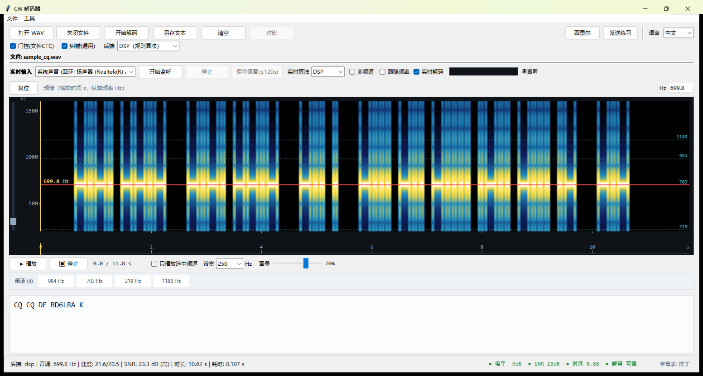
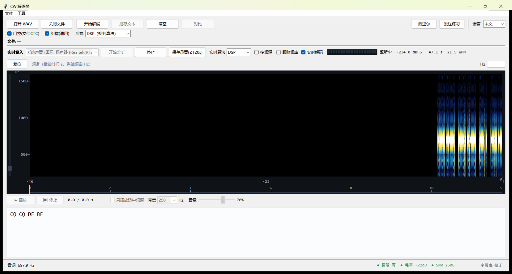
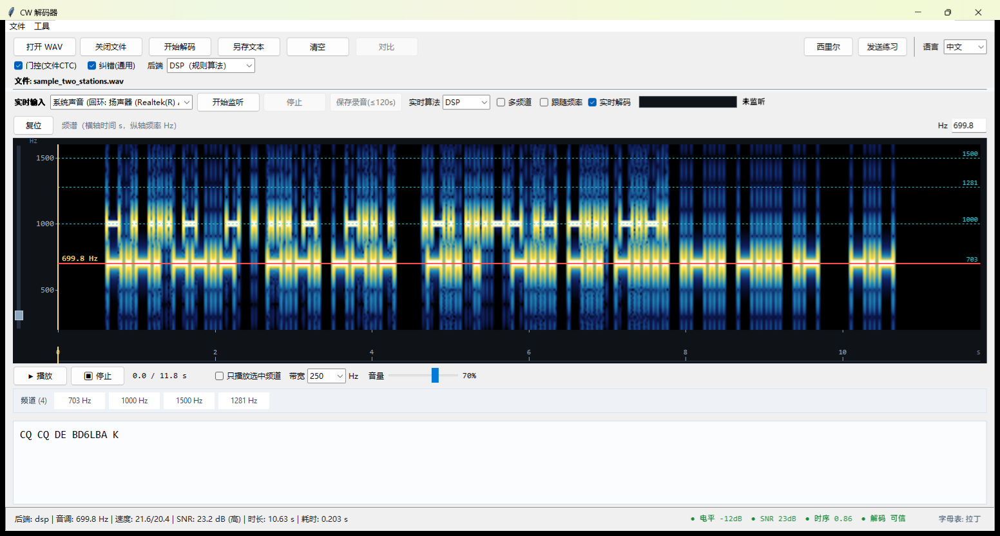

# CW Decoder · 摩斯码解码器

一个**离线、免费、开源**的 CW（摩斯码）解码器：读 WAV 文件，或实时监听系统声音 / 麦克风。
内置 **DSP 规则算法** 与 **CTC 神经网络** 两种后端，带多频道扫描、纠错、瀑布图、发报练习。

> 界面支持中文 / English / Русский · 启动即铺满工作区 · Windows 桌面程序 · 不联网、不上传任何数据
>
> **项目地址：<https://github.com/thunder719x/cw-decoder>**
> **下载最新版：<https://github.com/thunder719x/cw-decoder/releases/latest>**



---

## 特性

| 功能 | 说明 |
|---|---|
| **两种解码后端** | DSP（规则算法，快而可解释）、CTC（神经网络，抗噪抗衰落） |
| **自动选择** | 两边各跑一遍，按一致度 + SNR 选更可靠的结果（长文件且干净时直接用 DSP，省时间） |
| **实时监听** | 系统声音（回环）或麦克风，音调自动锁定，5 秒内出字 |
| **跟随换台** | 对方换频率时自动跟过去（可关，默认关） |
| **多频道扫描** | 一个频段里同时发现多个 CW 信号，列出 频率 / 强度 / 速度 / 呼号 |
| **俄文支持** | 32 个西里尔字母的俄文摩斯表（Ё 与 Е 同码，按 Е 处理），整段按西里尔输出 |
| **后处理** | 只做空格修复（粘连词拆开）；单词替换已实测无收益并停用 |
| **发报练习** | 18 条模板（中/英/俄），可调速度与音调，试听并保存 WAV |
| **瀑布图 / 播放** | 滚动瀑布、频谱缩放、按频道回放、时间轴跳转 |
| **信号质量提示** | 文件模式：电平 / SNR / 时序 / 解码；实时模式：信号 / 电平 / SNR；停止监听后数值冻结保留（标「已停止 ·（保持）」），复位时清空；悬停看阈值与明细 |
| **界面语言** | 中文 / English / Русский 一键切换（132 项文案，含悬停说明） |
| **可移植** | 纯 Python + 本地模型，不依赖云服务 |

### 实时 + 多频道





---

## 快速开始

### 方式 A：下载打包版（推荐给普通用户）

> 直接下载最新版：<https://github.com/thunder719x/cw-decoder/releases/latest>

```
1. 打开上面的链接，下载 cw-decoder-vX.Y.Z-win64.zip
2. 解压到任意可写目录（例如 D:\CWDecoder，不要放 Program Files）
3. 双击 cw-decoder.exe
```

首次运行可能遇到：

```
· Windows 提示"已保护你的电脑" → 更多信息 → 仍要运行
· 杀软提示可疑 → 加入白名单（PyInstaller 程序的常见误报）
```

### 方式 B：源码运行（需要 Python 3.10+）

```bash
git clone https://github.com/thunder719x/cw-decoder.git
cd cw-decoder

# 方式 1：装到系统 Python
python -m pip install -r requirements.txt
python run.py

# 方式 2：用虚拟环境（推荐，不污染系统）
python -m venv .venv
.venv\Scripts\pip install -r requirements.txt
.venv\Scripts\python run.py
```

也可以直接访问 <https://github.com/thunder719x/cw-decoder> → 绿色 **Code** → **Download ZIP**。

Windows 也可以直接双击 `run.bat`：它会依次尝试 `python\python.exe`、`py -3`、`python`、`python3`，
并检查 numpy / scipy / sounddevice 是否装了。

> 机器上有多个 Python 时，在本目录新建 `python_path.txt`，第一行写解释器完整路径即可，
> 例如 `C:\Python312\python.exe`（该文件不会上传到仓库）。

> 依赖：`numpy` `scipy` `sounddevice` `PyAudioWPatch` `soundcard` `onnxruntime` `pillow`
> （`tkinter` 随 Python 自带）

---

## 界面速览

```
┌ 文件操作：打开 WAV / 关闭文件 / 开始解码 / 另存文本 / 清空 / 对比 ─────┐
│ 设置行：门控 / 纠错 / 后端（DSP·CTC·自动）                            │
│ 实时行：输入设备 / 开始·停止·保存录音 / 实时算法 / 多频道 / 跟随频率    │
│ 频谱：纵轴频率，横轴时间（滚轮缩放，左侧滑块平移，「复位」清空）        │
│ 播放条：播放 / 时间轴 / 只播选中频道 / 带宽 / 音量                     │
│ 频道：候选频道（文件模式）或多频道列表（实时模式）                      │
│ 解码结果：文本区                                                      │
│ 状态栏：后端 / 音调 / 速度 / SNR / 字母表                              │
└──────────────────────────────────────────────────────────────────────┘
```

---

## 文件模式

```
① 打开 WAV（工具栏「打开 WAV」按钮）
② 选后端：DSP / CTC / 自动
③ 点「开始解码」
④ 需要时：另存文本 / 西里尔（俄文）/ 对比（两后端并排）
```

**支持的输入**

```
· WAV：PCM 8/16/24/32 位，单声道或立体声，任意采样率（内部重采样到 8 kHz）
· 视频/其它格式：先用 ffmpeg 转成 WAV
    ffmpeg -i in.mp4 -ac 1 -ar 8000 out.wav
```

**输出**（写入 `out/`，若程序目录不可写会自动改写到用户目录）

```
<name>.json       结构化结果（文本、音调、WPM、SNR、码元时序）
<name>.marks.csv  码元级调试数据（每个点/划的时长，便于分析）
```

---

## 实时模式

```
① 实时输入：系统声音（回环）或麦克风
② 点「开始监听」，约 2–5 秒锁定音调
③ 文本开始增长；「停止」会冻结瀑布
④ 「复位」清空视图、频谱和文本
```

**要点**

```
· 音调自动锁定；也可在 Hz 输入框手动指定
· 勾选「跟随频率」后，对方换台时会自动跟过去（默认关闭）
· 勾选「多频道」会列出当前频段内的多个 CW 信号
· 停止后文本保留，但不会因为点频道/改 Hz 而重新解码
· 录音缓冲上限 120 秒（「保存录音(≤120s)」按钮上有标注）
```

**遇到信号飘（QSB）或很弱时，请切到 CTC 后端**（原因见下一节）。

---

## 两种后端怎么选

程序有两种解码算法，**没有"更好的那个"，只有"更适合当前信号的那个"**。

| 场景 | DSP | CTC |
|---|---|---|
| 干净信号（10–40 WPM） | **0.00** | 0.03–0.59（长文件更差，见技术文档 §9.5） |
| 弱信号 −8 dB | 0.31 | **0.00** |
| 弱信号 −10 dB | 3.46（崩） | **0.00** |
| **QSB 慢衰落** | **0.54** | **0.00** |
| **QSB 快衰落** | **1.00** | **0.00** |
| 手键慢速（<15 WPM） | **正常** | 自动回退到 DSP |
| 连续发报（几乎无词间隔） | 单词粘连 | **能补空格** |

（数字是 CER，字符错误率，越低越好；0.00 = 与原文完全一致）
（CTC 的弱信号数字来自合成/单一素材抽样，样本量有限）

**怎么选**

```
① 信号干净、速度正常（≥15 WPM）      → DSP
② 信号很弱（沙沙里夹细声）            → CTC
③ 信号忽强忽弱（QSB）                 → CTC   ← 最常见误区
④ 连续发报、听不出词与词间隔          → CTC
⑤ 手键、慢速、点划拉得很长            → DSP
⑥ 不知道                              → 自动
```

> 自动后端在"弱信号"和"干净信号"上选得很准，但**在 QSB 衰落时可能选错**（它会挑 DSP）。
> 明确知道信号在飘时，请手动选 CTC。

更详细的原理与参数见 [`docs/technical.md`](docs/technical.md)。

---

## 示例音频

`samples/` 里有四个可直接试的文件（见 [`samples/README.md`](samples/README.md)）：

| 文件 | 内容 | 用途 |
|---|---|---|
| `sample_cq.wav` | 20 WPM / 700 Hz，干净 | 验证程序是否正常 |
| `sample_multi_freq.wav` | 700 → 1000 → 700 Hz 换台 | 验证「跟随频率」 |
| `sample_noisy.wav` | 8 dB 噪声 + 工频 | 模拟麦克风环境 |
| `sample_two_stations.wav` | 700 与 1000 Hz 同时发报 | 验证多频道扫描 |

---

## 常见问题

### 1. 实时明显比文件模式差

先关掉系统「音频增强」：

```
设置 → 系统 → 声音 → 扬声器 → 增强 → 关闭"音频增强 / 响度均衡"
（Realtek 音频管理器里也关掉"响度均衡""智能音量"）
```

系统压缩动态范围会把按键/间隙对比度从 ~17 dB 压到 ~10 dB，实时解码会明显变差。
程序会自动检测：对比度 < 11 dB 时状态栏会提示。

### 2. 实时一直不出字

```
① 前几秒不出字是正常的（在等音调锁定）
② 看状态栏有没有音调；没有 → 信号太弱或设备选错
③ 确认勾选了「实时解码」
```

### 3. 双击 run.bat 报 `No module named numpy`

```
用装了依赖的解释器运行：
  python -m pip install -r requirements.txt
  python run.py
```

### 4. 窗口找不到

```
再次双击 run.bat → 会把已有窗口切到前台（单实例保护）
```

### 5. 换台后没有新文本

```
勾选「跟随频率」，或手动在 Hz 输入框填新频率
```

### 6. 功能突然不响应 / 界面没反应（反馈问题时请附上日志）

```
程序会把界面层的异常记到：
  %LOCALAPPDATA%\CWDecoder\ui_errors.log

在资源管理器地址栏粘贴上面这一行即可打开。
正常使用不会产生任何内容；反馈问题时把这个文件一起发来，
能直接定位是哪一步出的错。文件里只有错误堆栈，不含音频或文本内容。
```

---

## 已知限制（诚实清单）

```
· 两台同频 → 物理上分不开
· 极弱信号（< −14 dB）→ 抄不下来
· 手键极不匀（> ±35%）→ 开始出错
· 强干扰段（QRM）→ 无法避免，人耳也难
· 衰落（QSB）→ DSP 会成片丢字，切 CTC 可解决
· 连续两个呼号粘连（ON7DQON7DQ）→ 不猜，保持原样
· 全"划"的短文本（如单独的 T）存在歧义（摩斯码本身如此）
· FSK 调制的 CW → 原理不同，不支持
· 数字为主的报文 + Farnsworth 极慢（有效 5 WPM）时，空格可能错位
  （例如 `5NN 001 TU` 显示成 `5 N N 0 0 1 T U`；字符本身不会错）
· CTC 在 <15 WPM 时会成片乱码 → 程序按设计自动改用 DSP，并在状态栏标注
  （所以慢速场景看到的是 DSP 的结果，不是 CTC 的）
```

---

## 技术细节

```
docs/technical.md     算法、参数、公式、测试方法与实测数据
docs/packaging.md     如何打包成 exe、如何发布
docs/NOTICE-models.md 模型来源说明
```

---

## 许可证

本项目采用 **GNU General Public License v3.0 or later**（GPL-3.0-or-later），
见 [LICENSE](LICENSE)。

```
Copyright (c) 2026 BD6LBA <https://github.com/thunder719x>
```

**你可以**：自由使用、修改、分发，包括商用。
**你需要**：保留版权声明与许可证；分发衍生作品时同样以 GPL 开源并提供源码。

**名称与图标**不随代码授权：未经许可，不得在衍生分发中使用
「CW Decoder / CW 解码器」名称与本项目图标。

---

## 模型来源与致谢

`models/ctc/acoustic.onnx` 是第三方 CTC 声学模型（用于弱信号解码），
其版权与许可**独立于**本项目代码，详见 [`docs/NOTICE-models.md`](docs/NOTICE-models.md)。

参考与致谢：

```
· 国际摩斯码与俄文摩斯码表（ITU / 俄文标准）
· 公开的 CW 解码与多频道信号处理的一般思路（门限、单位时长跟踪、分音调检测）
· 各位在论坛与邮件列表里分享实测数据与经验的火腿
```

---

## 更新记录

见 [CHANGELOG.md](CHANGELOG.md)。
