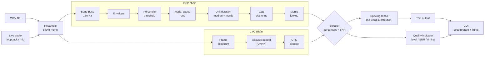

# CW Decoder 技术说明

> 本文档描述程序的算法、参数与实测数据，供想了解原理、二次开发或复现测试的人参考。
> 版本对应 **v0.1.2**（2026-11-28）。项目地址：<https://github.com/thunder719x/cw-decoder>
> 文中数值均为本机（Windows 11 / Python 3.12 / Realtek 板载声卡）实测。
>
> 本次更新：俄语界面、启动最大化、停用单词替换、外部对比（multimon-ng）、
> 质量灯校准改为可复现的 17 样本。

---

## 目录

1. 总体架构
2. DSP 链路
3. CTC 链路
4. 自动后端
5. 实时解码
6. 多频道扫描
7. 后处理（纠错）
8. 参数总表
9. 测试方法与实测数据
10. 已知限制与失败分析
11. 信号质量指示灯
12. 界面与本地化

---

## 1. 总体架构

```
             ┌──────────────┐
  WAV 文件 ──▶│  read_wav    │──┐
             └──────────────┘  │
                               ▼
 声卡/麦克风 ─▶ CaptureEngine ─▶ 重采样到 8 kHz ─┬─▶ DSP 链路 ─┐
   (48k)      (120 s 缓冲)                      ├─▶ CTC 链路 ─┼─▶ 文本
                                                └─▶ 多频道扫描 │
                                                              ▼
                                                    GUI（Tk）+ 瀑布 + 播放
```

**系统框图**（GitHub 可直接渲染；离线可看 `images/fig4_system.png`）



**模块职责**

| 模块 | 作用 |
|---|---|
| `capture.py` | 采集（WASAPI 回环 / 麦克风），统一输出 8 kHz 单声道 |
| `dsp.py` | 规则算法：带通、包络、门限、游程、单位时长、间隔阈值、查表 |
| `ctc.py` | 神经网络：11 维声学特征 + ONNX 推理 + 贪心解码 |
| `auto.py` | 两后端都跑，按一致度/结构分/SNR 选一个 |
| `pipeline.py` | 文件解码流水线（含门控）、写盘 |
| `window_dec.py` | 实时解码：滚动重解 + 文本合并 + 音调跟踪 |
| `channels.py` | 多频道发现与跟踪 |
| `correct.py` | 纠错与空格修复 |
| `waterfall.py` / `player.py` / `gui.py` | 可视化、回放、界面 |

---

## 2. DSP 链路

### 2.1 预处理

```
读 WAV（任意采样率/位深/声道）
  → 混为单声道
  → 重采样到 8 kHz（Butterworth 低通抗混叠后多相重采样）
  → 去掉直流
  → 归一化到峰值 1.0
  → 裁掉首尾静音（阈值 0.02，保留 0.3 s 余量）
```

**为什么裁静音**：门限用分位数估计，长段静音会把 20% 分位压到极低，导致门限失真。

### 2.2 音调估计

```
方法：FFT 谱峰 + 候选试解择优
· 先在 200–1600 Hz 找谱峰（±30 Hz / ±60 Hz 各试解一遍）
· 用"解码文本质量分"挑最好的候选
· 多频道/实时场景另有 pick_tone_robust()：3 点平滑 + 中位数抑制
```

### 2.3 带通

```
FFT 域理想带通：中心 = 音调，带宽默认 180 Hz（±90）
· 窄（100–120 Hz）：抗噪好，但音调漂移 >50 Hz 会掉信号
· 宽（240–300 Hz）：容忍漂移，但引入更多噪声
```

### 2.4 包络

```
包络 = |带通信号| 的 6 ms 滑动平均
（等效于整流 + 低通；6 ms 远小于 30 WPM 的 40 ms 点，不糊边）
```

### 2.5 自适应门限

```
lo = 20% 分位    hi = 90% 分位
ratio_db = 20*log10(hi/lo)

ratio_db ≥ 13 dB → 门限 = lo + 0.45*(hi-lo)     （正常信号）
9 ≤ ratio < 13   → 0.62
5 ≤ ratio < 9    → 0.72
ratio < 5        → 0.80
```

**为什么自适应**：Windows/Realtek 的"响度均衡/音频增强"会把按键压低、动态范围从 ~17 dB 压到 ~10 dB，
此时固定的 45% 门限会把按键尾部算成信号，整段变成 `TTTT`。提高门限可恢复。

**若 hi ≤ 1.6×lo**：退回 1-D k-means 两簇，用簇心作 lo/hi。

### 2.6 游程清理

```
· 短于 8 ms 的游程：翻转（当作毛刺/接触不良）
· 相邻同状态合并
```

### 2.7 单位时长估计（关键）

```
① 抗毛刺：取 marks 的中位数
   若点位极少（中位数 > 2.2×最短间隙），改用 25 分位
② "全是划"修正：若最短间隙 g_short 满足 2.2*g_short < unit ≤ 4.2*g_short
   → unit /= 3（对应俄文 Ш = "----" 这类全划文本）
③ 受限惯性跟踪：
   u ← u + 0.06*(d - u)，仅当 0.5u ≤ d ≤ 1.8u；夹在 20–200 ms
④ WPM = 1200 / unit(ms)
```

**为什么用中位数**：压缩/接触不良会产生 8–20 ms 的毛刺，早期用 k-means 时会被这些毛刺
带偏到 16 ms，导致所有点划比例失真、整段变 `T`。

### 2.8 间隔阈值

```
字符边界固定 2.0 单位（元素间隔 = 1 单位，字符间隔 = 3 单位）

词边界：对"长间隙"（2–90 单位）取对数后做 1-D k-means（k=2）
  若两簇比 > 1.35：
      · 字母簇 = 低簇、词簇 = 高簇
      · 先算几何平均 sqrt(c1*c2)
      · 但不允许超过"字母簇 × 1.25"（否则少数偏短的词间隔会被并进上一个词）
  否则退回 max(4.5, 1.5*c1)
下限 3.8 单位，上限 45 单位
```

**为什么用"跟着字母间隔走"而不是固定倍数**：

```
标准 CW      字母 3 单位 / 词 7 单位
手键         字母 5 单位 / 词 9 单位
Farnsworth   字母 18 单位 / 词 36 单位（整体放大约 4 倍）
```

固定阈值（早期版本用 18 单位上限）在 Farnsworth 慢速下会把字母间隔当成词间隔，
导致"每个字母一个单词"（实测 ARRL 5 WPM：367 个词 vs 参考 86 个）。
改为按字母簇推算后，同一素材恢复到 94 词，字符错误率仍为 0.000。

**上限从 18 放宽到 45 的原因**：Farnsworth 5 WPM 的词间隔可达 36–60 单位。

### 2.8.1 有效速度（Farnsworth）

```
wpm     = 1200 / 单位时长(ms)          ← 字符速度（点划多快）
wpm_eff = 1.2 × 总标准单位数 / 时长(秒)  ← 有效速度（整体多慢）
```

**为什么用 PARIS 标准反算**：Farnsworth 只拉长字母/词间隔，不改变点划长度。
把整段折算成"标准单位数"再除以真实时长，与"数某个间隔"无关，
标准码与 Farnsworth 都适用。实测 ARRL 素材：5/13/25/40 WPM 全部估准（误差 <0.2 WPM）。

界面状态栏显示为 `14.8/5.0 WPM`（字符速度/有效速度）。

### 2.9 查表

```
国际表（拉丁）：MORSE[code]
俄文表（西里尔）：RU_MORSE[code]
两者共用同一批码，同一串码在两套表里含义不同：
  --.-  = Q  / Щ
  -..-  = X  / Ь
  ...-  = V  / Ж
  ....  = H  / Х
  .-.-  = (无) / Я
  ----  = (无) / Ш
```

**选定字母表后整段按该表输出**（包含呼号）。理由：摩斯码里没有"这是呼号"的信息，
逐词猜测会在弱信号下产生半拉丁半西里尔的混合文本。

---

## 3. CTC 链路

```
帧移 40 采样 @8 kHz → 200 帧/秒
FFT 256 点，取 9 个频带能量 + AGC 包络 + 包络导数 = 11 维
  → ONNX 模型（models/ctc/acoustic.onnx）
  → 每帧输出 65 个 token 的概率（含 blank）
  → 贪心：取 argmax，合并重复、去 blank
  → 符号序列 → 查表 → 文本
```

**特征说明**

```
· AGC 包络：用时间常数自适应的归一化包络（对 QSB/弱信号不敏感）
· 导数：捕捉起落沿，帮助区分点/划边界
· 9 个谱 bin：300–1500 Hz 内的能量分布，用于区分信号与噪声
```

**优缺点**

```
优点：弱信号（−14 dB）、衰落（QSB）、噪声下远好于 DSP
缺点：对慢速手键（<15 WPM，点划比例被拉长）系统性乱码；
      偶尔在词首插入多余字母
```

---

## 4. 自动后端

```
1) 快速通道：时长 ≥90 s 且 DSP 文本无 "?" 且 SNR ≥15 dB → 直接用 DSP（不跑 CTC）
2) 两边都跑，计算字符级一致度 agree
3) agree ≥ 0.85            → CTC（两者一致，CTC 更少漏字）
   0.60 ≤ agree < 0.85     → 比较"结构分"（词/呼号/合法字符比例），高者胜
   agree < 0.60 且 SNR <10 → CTC（弱信号）
   其它                     → DSP
```

**已知缺陷**：QSB 衰落时两路差异大（agree 低），但 SNR 不低 → 会误选 DSP。
此时应手动选 CTC。

---

## 5. 实时解码

### 5.1 结构

```
采集（48 kHz 原始块，4096 帧/块 ≈ 85 ms）
  → CaptureEngine 缓冲（最近 120 s）
  → WindowDecoder.feed() 逐个累积
  → 解码线程每 hop 秒重解一次
  → 文本通过队列回主线程（不跨线程碰 Tk）
```

### 5.2 重解与合并

```
hop = max(hop_s, 当前缓冲时长 × 0.012)
hop_s 会随单次解码耗时增长（×2.5），避免解码跟不上采集

每次解码整段缓冲 → 新文本 new_text
合并：求 old 与 new_text 的最长公共前缀 n
  → 保留 old[:n]，替换其后内容
（已抄对的前缀不会被噪声推翻）
```

### 5.3 音调锁定

```
每 2 秒（未锁定时）/ 8 秒（已锁定时）估计一次音调
要求：音调性 ≥30（噪声约 10，CW 约 55–80）
     连续两次估计相差 ≤10 Hz → 锁定
锁定后用最近 20 s 缓冲估计值作中位数，避免单次抖动
```

### 5.4 跟随换台（默认关闭）

```
触发：连续 3 秒没有新文本 + 电平正常
判据：新音调与当前差 >25 Hz，且连续两次一致（±15 Hz）
    或：新峰能量 > 当前音调能量 ×2.5（快速切换）

切换动作：
  ① 把已抄到的文本存为前缀
  ② 在新频率上重新起步：
     用 find_onset() 在最近 15 s 缓冲里找"最后一段 ≥0.8 s 静音"的结束点
     （再往前回扫 0.9 s），从该点开始的音频作为新起点
  ③ 清空解码器的文本与缓冲，读取新起点音频
  ④ 丢弃队列中还没处理的旧更新
```

**为什么按静音起点**：换台时新报文总是从一段停顿之后开始；按起点重新解码，
既不丢开头，也不会把旧频率的残余重解一遍（早期版本因此出现"三段变四段"）。

### 5.5 缓冲与内存

```
采集缓冲：120 s（约 23 MB @48k float32）
解码缓冲：整个会话（重解成本随长度增长，hop 自适应）
实测：连续 5 分钟，内存 119–152 MB 波动，无泄漏
```

---

## 6. 多频道扫描

```
① 频谱峰检测
   · 频段 250–2500 Hz，3 点平滑，峰需高出中位数 12 dB
   · 离更强峰 <150 Hz 且弱 8 dB 以上 → 判为边带丢弃
   · 相邻频道间隔 <40 Hz 合并
② CW 调制校验
   · 带内包络的调制深度 ≥8 dB，占空比 0.05–0.85
③ 解码校验
   · 用最近 6 s 音频按该频率解一次，规律性 ≥0.6 才确认
④ 跟踪
   · 连续 2 次命中才转正；连续 5 次未命中退休
   · 频率用 0.75/0.25 平滑，避免抖动
   · 记忆上次呼号，避免列表闪烁
```

---

## 7. 后处理（纠错）

**2026-11-27 起：单词替换停用，只保留空格修复。**

实测依据（ARRL 9 个公开素材，10,363 字符）：

| 变体 | 字符错误 | CER |
|---|---|---|
| 全关 | 0 | 0.000 |
| 仅空格修复 | 0 | 0.000 |
| 仅词替换 | 10 | 0.001 |
| 全开（旧版） | 10 | 0.001 |

```
· 词替换：在全部已测场景（干净素材 / 麦克风 11 条 / −5…−12 dB 合成）
  收益为 0，且引入 10 个错误（PUT→ABT、QSO→QSY、HSS→HIS 等）
  → 根因：英文白名单仅约 200 词，43%–50% 的正常词被判为"未知词"
· 空格修复：不改变字母，只补空格，无错误
```

**适用范围：文件模式与实时模式一致**
```
· 文件：pipeline.decode_file 不再调用 correct_text
· 实时：StreamDecoder 与界面显示路径同样只做 repair_spacing
  （此前界面在勾选"纠错"时会对实时文本做词替换，已移除）
```

**空格修复的约束（避免误拆正常词）：**
```
仅当以下任一成立时才拆分：
  · 切分段数 ≥ 3（如 CQCQDE → CQ CQ DE）
  · 含数字（如 DEBD6LBA → DE BD6LBA）
  · 整串长度 ≥ 10
反例：DROP（2 段、无数字、长度 4）不再被拆成 "DR OP"
```

---

## 8. 参数总表

| 参数 | 默认 | 范围 | 影响 |
|---|---|---|---|
| 目标采样率 | 8000 Hz | — | 解码统一在 8 kHz 上做 |
| 带通带宽 | 180 Hz | 100–300 | 窄=抗噪，宽=容忍漂移 |
| 包络窗 | 6 ms | 4–10 | 太大糊边，太小抖动 |
| 门限分位 | 20% / 90% | — | 抗脉冲噪声 |
| 门限比例 | 0.45–0.80 | 自适应 | 动态范围越小，取值越大 |
| 最短游程 | 8 ms | 5–12 | 去毛刺 |
| 单位时长 | 中位数 | 15–200 ms | 抗毛刺 |
| 惯性系数 | 0.06 | 0.02–0.1 | 跟随速度 |
| 字符边界 | 2.0 单位 | 1.8–3.2 | 点划内/间分界 |
| 词边界 | 聚类自适应 | 3.8–18 | 词间隔分界 |
| 最短解码时长 | 1.0 s | 0.4–2.0 | 太短不输出（防噪声） |
| 门控·音调性 | 22 dB | 15–30 | 低于此值视为"不是 CW" |
| 门控·规律性 | 0.45 | 0.30–0.60 | 低于此值结果置空（13 样本零误杀，0.60 会误杀 QSO） |
| 实时 hop | ≥0.8 s | 自适应 | 重解频率 |
| 音调锁定 | 两次 ±10 Hz | — | 防误锁 |
| 跟随触发 | 3 s 无新文本 | 2–5 s | 灵敏度 |
| 静音起点 | ≥0.8 s | 0.5–1.5 s | 换台重建位置 |
| 录音缓冲 | 120 s | — | 内存与保存时长 |
| 采集块 | 4096 帧 | 1024–8192 | 抗卡顿 vs 延迟 |

---


### 8.1 参数为什么这样选（实测对比）

以下数据来自 2026-11-27 的离线脚本验证（不改源码，单独跑解码函数）。

#### 8.1.1 带通带宽：为什么固定 180 Hz，而不按速度自适应

有社区经验建议 20 WPM 用 20–40 Hz、高速用更宽。我们实测：

| 条件 | 180 Hz（当前） | 80 Hz | 自适应（1.6×WPM，30–150 Hz） |
|---|---|---|---|
| 10 WPM / −8 dB | **0.238** | 0.143 | **0.000** |
| 20 WPM / −8 dB | **0.095** | 0.000 | **0.000** |
| 30 WPM / −8 dB | 0.048 | 0.048 | **0.000** |
| ≥ −5 dB（所有速度） | 0.000 | 0.000 | 0.000 |

（数字为 CER，越低越好）

**结论：合成信号上，窄带确实更好；但真实录音上会崩：**

| 素材 | 180 Hz | 80 Hz | 自适应 |
|---|---|---|---|
| ARRL 5/13/25/40 WPM | CER 0.000 | 相同 | 相同 |
| QSO（真实，150 秒） | 757 字 | 303 字 | **2474 字（乱码）** |
| CW_massive（堆积） | 345 字 | 434 字 | 356 字 |

**原因**：真实录音存在音调漂移、信号带宽更宽、可能多台共存；窄带会切掉部分信号，
解码器在"半个信号"上乱猜。而"双解取优"所用的可读性打分在 QSO 上选错。

**因此保持固定 180 Hz**：牺牲极弱信号的少量收益，换取真实录音的稳定性。

#### 8.1.2 静噪（squelch）：为什么不需要额外加

| 输入 | 电平 | 当前输出 |
|---|---|---|
| 纯白噪声 5 秒 | −26 dBFS | **0 字** |
| 工频 50 Hz + 噪声 | −28 dBFS | **0 字** |
| 极低电平信号（−53 dBFS） | −53 dBFS | **正确解出 `CQ TEST`** |
| 正常信号 | −24 dBFS | 正确 |

**结论**：现有门限已经天然抑制噪声（输出空），而按电平静噪会误伤弱信号，故不采用。

#### 8.1.3 音调跟踪：为什么不采用"锁定后允许漂移"的方案

```
常见做法：锁定后允许 ±Hz 漂移，超出才重新锁定
本项目：pick_tone_robust() —— 试若干候选音调，按解码质量择优
        实时模式另有音调锁定（两次一致 ±10 Hz）与跟随换台
```

按"解码质量"选音调比按"漂移范围"更直接；实测未发现"受限于漂移"的失败案例，故不改。

---

## 9. 测试方法与实测数据

### 9.1 指标

```
CER（字符错误率）= 编辑距离(参考, 结果) / len(参考)
0.00 = 完全一致；0.10 = 每 10 个字符错 1 个
```

### 9.2 合成用例（真值已知）

| 项目 | 结果 |
|---|---|
| 速度 10–30 WPM | CER 0.00 |
| 速度 40 WPM（合成器） | 1.00 — 被「规律性 >= 0.45」门控清空（35 WPM 为 0.44、40 WPM 为 0.41；真实 40 WPM 素材为 1.00，见 9.5） |
| 音调 400–1500 Hz | 0.00 |
| SNR 20 … −5 dB（DSP） | 0.00 |
| SNR −8 / −10 / −12 dB（CTC） | 0.31 / 0.00 / 0.15（单次抽样，存在波动） |
| 手键抖动 ±30% | 0.00 |
| Farnsworth（慢速）间隔 4 组 | 0.00 |
| 报文内停顿 2 s / 5 s | 0.00 |
| 削顶 2.5 倍 | 0.00 |
| 工频 + 8 dB 噪声 | 0.00 |
| 双台干扰（不同音调） | 0.00 |
| **QSB 衰落（DSP）** | **0.54 / 1.00 / 0.46** |
| **QSB 衰落（CTC）** | **0.00** |

### 9.3 真实录音（与文件模式对照）

| 素材 | 时长 | 结果 |
|---|---|---|
| HA8A 信标 | 19 s | 一致 |
| VK4RBB | 32 s | 一致 |
| 《诗篇》23（手键） | 30 s | 一致 |
| Wikipedia 音频 | 53 s | 一致 |
| 真实 QSO（SQ5VCO / ON7DQ） | 150 s | 一致 |
| 比赛堆积（多台） | 178 s | 326 字（含空格），速度 35 WPM |

### 9.4 性能

| 项目 | 数值 |
|---|---|
| DSP 解码 30 s | 0.02 s |
| DSP 解码 178 s | 0.53 s |
| CTC 解码 19 s | 0.40 s |
| 实时延迟（锁定后） | 0.8–1.5 s |
| 多频道扫描（6 频道） | 15 ms/次 |
| 内存（实时 5 分钟） | 119–152 MB |

---

### 9.5 真实公开素材：ARRL W1AW 练习报文（2026-11-27 首测，11-28 复测）

素材：arrl.org 官方 W1AW Code Practice 音频 + 官方文本（文本即发报内容，可作真值）。
9 个文件，覆盖 5–40 WPM，合计约 1.1 万字符，单文件时长 3–35 分钟。

| 名义速度 | 参考字符 | CER（DSP） | CER（auto） | CER（CTC） | 说明 |
|---|---|---|---|---|---|
| 5 WPM | 367 | **0.000** | 0.000 | 0.000 | <15 WPM：CTC 回退到 DSP |
| 10 WPM | 351 | **0.000** | 0.000 | 0.000 | 同上 |
| 13 WPM | 836 | **0.000** | 0.000 | 0.000 | 同上 |
| 15 WPM | 430 | **0.000** | 0.000 | 0.000 | CTC 真实输出 |
| 18 WPM | 2999 | **0.000** | 0.000 | 0.585 | 37 分钟长文件 |
| 20 WPM | 690 | **0.000** | 0.000 | 0.135 | |
| 30 WPM | 1010 | **0.000** | 0.000 | 0.328 | |
| 35 WPM | 1186 | **0.000** | 0.000 | 0.155 | |
| 40 WPM | 2494 | **0.000** | 0.000 | 0.031 | |
| **合计** | **10363** | **0.000** | 0.000 | — | 0 个错误 |

**观察**

```
① 速度估计准确：wpm_eff 与名义值误差 ≤ 0.2 WPM（9 个文件全部命中）
② 干净信号：DSP 明显优于 CTC（CTC 0.031–0.585，最好一档也只有 0.031）
   → 自动后端在 9 个文件上全部选 DSP（reason=fast）
   → 但 CTC 的价值在弱信号/QSB（见 §9.2），不能据此说它"没用"
③ 旧版的 10 个错误全部来自"单词替换"，停用后为 0：
   · 单字母误判：PUT → ABT、PER → ABT、QSO → QSY、HSS → HIS
   · 词边界挪位：KNOW → "KN OW"、DROP → "DR OP"
④ 真实 40 WPM 文件 CER 0.000，而合成 40 WPM 用例 CER 1.00
   → 原因：合成波形上升/下降沿较软，35/40 WPM 时"规律性"降到 0.44 / 0.41，
     被 decode_gated 的 min_regularity = 0.45 门控清空（文本本身是解对的）
   → 真实素材规律性为 1.00，因此不受影响
   → 属于"门限卡在边界"的已知现象：高速 + 软键控会被误拦
```

**可复现**：音频/文本与评测脚本随投稿材料归档（`语料/arrl/`、`04_可复现/eval_arrl.py`、
`eval_ctc.py`），不随代码仓库发布（ARRL 素材版权）。

---

### 9.6 外部对比：multimon-ng（2026-11-28）

同一批 9 个 ARRL 文件，用常用开源解码器 multimon-ng 做参照。

**设置**：`-t raw -a MORSE_CW -q`（默认 dit/gap/threshold，未手工调优）
**输入**：先由 ffmpeg 转 22050 Hz 单声道 s16le raw（它不直接吃 8k WAV）

| 速度 | 本实现 CER | multimon-ng CER |
|---|---|---|
| 5 / 10 / 13 / 15 / 18 / 20 WPM | 0.000 | 0.000 |
| 30 WPM | 0.000 | 0.044 |
| 35 WPM | 0.000 | 0.159 |
| 40 WPM | 0.000 | 0.820 |
| **加权平均** | **0.0000** | **0.2197** |

**说明**

```
· 40 WPM 的退化不是"我们故意调坏"：试过 -d/-g 按点长匹配、-x 关自动阈值，
  CER 仍在 0.82–0.93 之间
· multimon-ng 面向交互式实时使用，不是为批处理录音棚素材设计的
· 因此这一节只作为"参照点"，不用于得出"谁更强"的结论
```

---

## 10. 已知限制与失败分析

| 现象 | 原因 | 是否能修 |
|---|---|---|
| QSB 时 DSP 成片丢字 | 全段分位门限对幅度变化敏感 | 用 CTC 可解；AGC 改造已验证但会破坏其他场景，未采用 |
| 自动后端在 QSB 选错 | 一致度低但 SNR 高 | 需要可靠的"衰落检测"，暂无真值数据验证 |
| 单字符（<1 s）无输出 | 最短解码时长 1 s | 可调，但会引入噪声误触发 |
| 单独的 T 被读成 E | 全划文本缺少"点"作参照 | 摩斯码本身歧义，需上下文 |
| 手键抖动 >±40% | 点划比例超出容差 | 物理极限 |
| 同频两台 | 频谱重叠 | 物理不可分 |
| 音调漂移 >120 Hz/条 | 单次估计固定 | 分段重估实测更差，未采用 |
| 数字为主 + Farnsworth 极慢（有效 5 WPM）时，空格错位（如 `5NN 001 TU` → `5 N N 0 0 1 T U`） | 数字是 5 码元长码，间隔分布出现第三簇，把词边界压低 | 字符错误率仍为 0.000，只是空格位置；场景很窄，暂不修，见下 |
| CTC 在 <15 WPM 时成片乱码 | 模型训练数据以标准节奏为主 | 已在 pipeline 里做慢速门控：<15 WPM 自动改用 DSP 并标注 `slow-speed->dsp` |

---

## 11. 信号质量指示灯
12. 界面与本地化

界面上有两套"指示灯"，含义不同，不能混用：

| 模式 | 显示 | 含义 |
|---|---|---|
| 文件模式 | 电平 / SNR / 时序 / 解码 | 对**整段音频**的结论 |
| 实时模式 | 信号 / 电平 / SNR | **最近 10 秒**的当前状态 |

设计输入是电台仪表的通用惯例（音频驱动指示 + SNR 读数 + 锁定状态），
原则是"灯少、含义单一、明细放在悬浮提示里"。

### 11.1 文件模式（4 灯）

| 灯 | 绿色 | 黄色 | 红色 | 依据 |
|---|---|---|---|---|
| 电平 | ≥ −28 dBFS | −33 ~ −28 | < −33 | 输入增益是否够 |
| SNR | ≥ 18 dB | 12 ~ 18 | < 12 | 180 Hz 带宽内的 key-on SNR |
| 时序 | 0.80 ~ 1.35 | 1.35 ~ 1.55 或 0.62 ~ 0.80 | > 1.55 或 < 0.62 | 点长 ÷ 元素间隔（混响/距离的指纹） |
| 解码 | 可信 | 可疑 | 不可信 | 文本可信度 + 规律性 |

**"解码"灯的判定（文本可信度）**

```
① ? 比例 > 12%                 → 不可信（解码器自己判不出的码元）
② 非 ASCII > 5%（拉丁模式）     → 不可信（串成西里尔字母；俄文模式豁免）
③ 无"有效词"且单字 > 30%        → 不可信（全是 E/T 碎片）
④ 以上轻度越界                  → 可疑
⑤ 其余                          → 可信
再叠加"规律性"（码元是否落在 1×/3× 单位网格，< 0.85 降档）
```

**为什么不用"单字词比例"单独判定**：比赛风格（`R R R K K 5NN TU`）单字多但完全正确，
早期版本会误报；改为"先看有没有有效词（呼号/常用词/K/R）"后，误报消失。

**校准数据**（17 个有真值样本，可复现）

```
构成：9 个 ARRL 文件 + 8 个合成（20/30 WPM × SNR 20/5/0/−5 dB）
漏报（灯绿但结果错）：0
误报（灯红但结果对）：0
脚本：投稿材料 06_待办与风险/附录_分析脚本/calibrate_lights.py
```

> 旧稿记录的"57 个样本"没有随材料保留，已替换为上面这组可复现数据。

### 11.2 实时模式（3 灯）

| 灯 | 规则 |
|---|---|
| 信号 | 有 / 无：电平 > −60 dBFS 且 音调性 ≥ 15（用**最近 2 秒**判断，反应快） |
| 电平 | 与文件模式同阈值（EMA 平滑后） |
| SNR | 与文件模式同阈值（EMA 平滑后） |

**时间与平滑参数**

```
窗口：最近 10 秒（不足 3 秒显示"—"）
刷新：每 1 秒一次（与解码 hop 解耦）
平滑：EMA，时间常数 τ = 3 秒
迟滞：颜色变化需连续 2 秒确认（防闪烁）
静音处理：信号转为"无"（灰）；电平/SNR 冻结保留上一次数值，
          方便发报结束后回看，复位/清空后才消失
```

**音调取值**：优先用解码器锁定的 f0，与本地估计值比较"音调性"，取更高者。
（不能用界面上的手动 Hz——可能是旧值，会把带通滤到信号外面。）

**实时模式不显示"解码"灯**：文本还在增长，可信度判断容易误导；
等停止监听后，用文件模式对整段判定。

#### 11.2.1 四种显示状态

| 状态 | 信号灯 | 电平和 SNR | 悬浮提示 |
|---|---|---|---|
| idle | `—` | `—` | 不弹 |
| live（有信号） | `● 信号 有` | 每秒刷新 | 实时信号质量（最近 10 秒） |
| live（无信号） | `● 信号 无` | 冻结在最后一次有信号的值 | 同上（数值为最后值） |
| stopped（停止监听） | `● 信号 —（已停止）` + 小字`（保持）` | 冻结保留 | 标题带"已停止 · 最后更新 时:分:秒"，末行"以上为最后数值；复位后清除" |

**要点**

```
· "已停止"用灰色：它既不是正常（绿），也不是故障（红）
· 数值冻结不置灰：方便回看最后一次电平和 SNR
· 复位 / 清空后回到 idle，全部消失（含"（保持）"标记）
· 仍在监听但没有信号时，仍显示"无"，不显示"（保持）"
```

#### 11.2.2 画布留白约束（改版面时注意）

```
画布底部 MARGIN_B = 26 px：
  刻度线 4 + 数字 12 + 上下空隙 ≈ 26
若调小，时间轴数字会被画布裁掉（"s" 单位直接看不见）
另外两个保险：
  · 标签 y 取 min(y0+ph+8, 画布高-14)
  · 最后一个刻度右对齐，"s" 放在它右侧，避免压字
```


#### 11.2.3 异常日志（排错用）

```
位置：%LOCALAPPDATA%\CWDecoder\ui_errors.log
内容：只有异常堆栈（函数名、行号、错误信息），不含音频、文本或用户输入
触发：仅当界面层真的出错；正常使用不会产生任何内容
保护：
  · 同一条错误 60 秒内只记一次（防止刷屏）
  · 文件超过 256 KB 自动截断，保留后半段
  · 目录不可写时静默放弃，不影响程序运行
```

界面层的 `except` 仍然会吞掉异常（行为不变），只是顺手留一条记录。
关键路径（实时刷新、瀑布喂数据、停止监听）已接入；清理类代码保持原样。

### 11.3 已知局限

```
· 阈值来自 17 个有真值样本的可复现校准（另加 13 个样本的阈值敏感性实验），不是理论最优
· "解码"灯是文本级启发式，麦克风11（点长双峰）这类
  "指标正常但结果错"的样本已能被标红，但不保证 100%
· SNR 参考带宽 180 Hz；与 500 Hz 参考的读数不可直接比较（差约 4.4 dB）
· 实时灯的数值在发报结束后是"冻结"的，代表最后一段有信号的时刻
· 时间轴标注的是瀑布缓冲的**满容量跨度**（约 40 秒），不是已填充的时长
```

---

## 12. 界面与本地化

```
支持语言：中文 / English / Русский
文案总数：132 条（含信号灯、表头、站内提示、悬停说明）
兜底规则：缺 key 时回落到英文，再回落到 key 本身（不会抛异常）
切换行为：立即刷新按钮、复选框、多频道表头、信号灯、状态栏、悬停说明
单实例：标题匹配三种语言（CW 解码器 / CW Decoder / CW декодер）
```

**窗口启动行为**

```
启动即最大化（Windows 的 zoomed 状态，自动避开任务栏）
频谱区与竖向滑块随窗口高度一起变化
还原后回到 1380×790（居中）
```

---

## 参考

- 国际摩斯码（ITU-R M.1677）
- 俄文摩斯码表（俄政府 1856 年颁布，对应 MTK-2 / KOI-7 / KOI-8）
